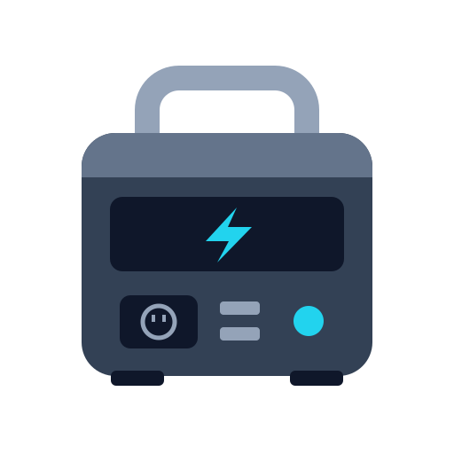

# Segway Cube for Home Assistant



[](https://github.com/nlemeshko/ha-segway-cube-integration/actions/workflows/validate.yml)

[Русская документация](README.ru.md) · **0.4.0 — public beta**

An unofficial local Bluetooth integration for Segway Cube portable power stations.
Designed for Cube 1000/2000; tested on one physical Cube with three battery modules.
Connect through Home Assistant Bluetooth or an active ESPHome Bluetooth proxy.
No Segway cloud account or MQTT broker is required.

## Features

- Automatic Cube discovery, including renamed stations.
- Encrypted BLE sessions released between polls.
- Charge, main temperature, battery-module count and power telemetry.
- 67 documented registers; compound battery/port fields remain raw values.
- AC/DC output, R-Drive, UPS and button-tone switches.
- AC charging power limit, fan mode, device/AC/DC idle timeouts and screen timeout.
  AC frequency selection appears only when the station declares support.
- New Bluetooth keys created in the setup wizard with confirmation on the station.
- Optional strict proxy selection: unavailable or busy selected proxies are retried
  without connecting through a different adapter.
- English/Russian UI and diagnostics that omit station keys and serial numbers.

## Requirements and tested compatibility

Home Assistant **2026.10.1 or later**, running Python 3.14. Only **2026.10.1** has
been validated; the minimum is intentionally conservative and does not guarantee
compatibility with future versions. Runtime Bluetooth/crypto dependencies are
provided by Home Assistant. ESPHome proxies must allow active connections:

```yaml
bluetooth_proxy:
  active: true
```

Keep the proxy close to the station. Close the Segway application before connecting;
if it keeps occupying the BLE connection, temporarily disable phone Bluetooth.

## Installation

### HACS custom repository

Add
`https://github.com/nlemeshko/ha-segway-cube-integration` to **HACS → Custom
repositories**, selecting **Integration**. Download **Segway Cube**, restart
Home Assistant and follow the setup steps below.

This is a custom repository; publication does not automatically add it to the
default HACS catalog. [HACS repository requirements](https://www.hacs.xyz/docs/publish/integration/).

### Manual

Copy `custom_components/segway_cube` to `/config/custom_components/segway_cube`,
including all files and subdirectories, then restart Home Assistant.

## Setup and Bluetooth authorization

1. Open **Settings → Devices & services** and configure the discovered **Segway Cube**,
   or add it manually. Choose the station's Bluetooth address.
2. To create a key, leave the Bluetooth-key field empty and enable button-confirmed
   key creation. Explicitly confirm the new binding: it can replace the phone app's key.
3. Wait for the wizard to request a button press, briefly press the station's power
   button **once without holding it**, and wait for setup to finish.
4. Alternatively, enter a known station key. A Home Assistant password is not a Cube key.

The wizard persists the candidate key before sending it to the station in the private
HA file `.storage/segway_cube.pairing`. Do not delete it during interrupted pairing;
the next attempt can recover the same key. Never publish this file or your HA backups.
Reconfiguration with an empty key field and key creation disabled preserves the current key.
Rebinding from the official application may require updating the HA key.

An optional local helper can retrieve a candidate key from an unencrypted iPhone backup
or exported Segway preferences plist. It reads only the Segway preferences and sends
nothing to a server; see [the Russian guide](README.ru.md#дополнительный-способ-bluetooth-ключ-из-iphone)
and `python tools/extract_iphone_key.py --help`. Prefer the built-in pairing wizard.

## Options and controls

Open **Settings → Devices & services → Segway Cube → Configure** to choose a
Bluetooth adapter/proxy or return to automatic selection. A pinned adapter is used
for polling, writes and reauthorization. Offline saved selections stay visible.
Strict selection is per Cube client and does not alter routing for other integrations.

Default polling interval is 30 seconds plus BLE session time. Details are fetched in
batches of eight registers; a new full cycle starts five minutes after the previous
one finishes. Intervals are configurable. Unread dynamic values become unavailable.

Use the normal switch/select entities in dashboards and HA automations. Charging
options start at 200 W and end at 1250 W or 1650 W depending on declared capabilities.
Writes preserve unrelated register bits and confirm the applied value by readback.
Station reset, firmware update and account unbinding are not provided as controls.

An advanced `segway_cube.set_setting` action is disabled by default. Its `value` is
the raw 16-bit register value. Prefer the normal entities; see
[the full guide](README.ru.md#экспериментальное-управление) and
[control mappings](docs/control-protocol.md).

## Beta validation and limitations

The integration has 78 automated tests. On hardware, authorization, telemetry and
proxy pinning succeeded; charging-limit and button-tone changes were read back and
restored. These results come from one station, not a broad compatibility matrix.

Complete new pairing through the HA wizard still needs a physical end-to-end test;
button pairing was hardware-tested directly from a Mac. AC/DC/UPS switching under
load, mains-loss UPS transitions, every timer/fan/R-Drive change and long-duration
stability have not been hardware-tested. Other models/firmware need confirmation.
Strict proxy selection uses an internal habluetooth backend hook and may require
changes after HA updates. See [TEST_REPORT.md](TEST_REPORT.md) for the precise scope.

## Development and bug reports

```sh
python3.14 -m venv .venv
source .venv/bin/activate
python -m pip install -r requirements-dev.txt
python -m pytest tests -q
python -m ruff check .
```

The GitHub workflow runs tests, Ruff, hassfest and HACS validation. Current hosted results are available from the validation badge above.
Report issues with your model, firmware, HA/integration versions and proxy details
via [GitHub Issues](https://github.com/nlemeshko/ha-segway-cube-integration/issues).
Review diagnostics before uploading: keys and serial numbers are omitted, but
adapter addresses are included. Never post keys, passwords, tokens, `.storage` files
or phone backups. See [CONTRIBUTING.md](CONTRIBUTING.md).

## License and sources

Apache-2.0; see [LICENSE](LICENSE) and [NOTICE](NOTICE), including attribution for
adapted cryptographic code and protocol metadata. The icon is an original project
illustration, not a vendor photograph or logo. This project is independent of Segway/Ninebot.

- [Cube protocol research](https://nootnooot.codeberg.page/segway-ninebot-ble/devices/segway-portable-power-station-cube/)
- [Reference BLE client](https://codeberg.org/NootNooot/segway-ninebot-ble-cli), commit `bb6f3d325237fa91e683df27f2197f9cb771e841`
- [Reference app / command metadata](https://codeberg.org/NootNooot/segway-ninebot-ble-app), commit `2115c1b93ec919e017e8931be09d77de8496ea79`
- [Home Assistant Bluetooth API](https://developers.home-assistant.io/docs/core/bluetooth/api/)

Control masks/options were checked against the official Cube application's device
configuration (server ID 1112, package 600002200). Vendor APKs, application binaries
and research decryption material are not distributed in this repository.
